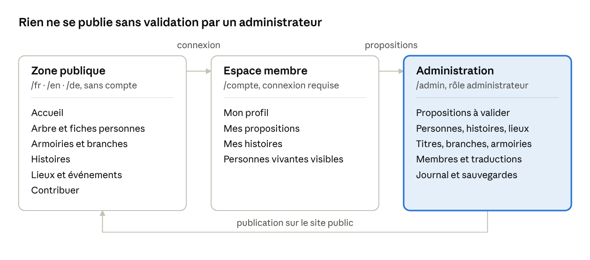

# Site de la maison de Croÿ — Cahier des charges pour Claude Code

Oct 10, 2026 · @Baudouin de Brosses

## 1. Mission

Tu construis le site de la maison de Croÿ : un lieu où chaque membre de la famille peut apprendre son histoire et s'y repérer. Ce document est ton cahier des charges. Lis-le en entier avant d'écrire une ligne de code, puis suis les 12 étapes de la section 8 dans l'ordre.

Le site répond à trois besoins :

- **Raconter** : l'histoire de la famille, ses titres, ses branches, ses armoiries, ses lieux.

- **Se repérer** : un arbre généalogique interactif où chaque personne a sa fiche, ses liens et ses mariages.

- **Enrichir** : les membres de la famille se connectent et proposent des ajouts ; un administrateur valide tout depuis un dashboard.

Le public visé est la famille elle-même, de l'adolescent au grand-parent. Beaucoup ne connaissent pas la généalogie. Le site doit donc être compréhensible sans explication, sur téléphone comme sur ordinateur.

**Règle absolue sur le contenu.** Tu n'inventes aucun fait : ni personne, ni date, ni titre, ni blason, ni anecdote. Les repères de la section 2 viennent de sources publiques : utilise-les comme contenu de départ, chacun marqué « à valider par la famille » dans le dashboard. Tout le reste (personnes récentes, photos, anecdotes familiales) sera fourni par la famille (section 10). S'il te manque une information, tu laisses un champ vide signalé, jamais une invention.

**L'esprit du site.** Ce n'est pas une archive poussiéreuse. C'est un site moderne, vivant et beau, qui donne envie d'explorer, comme le site d'un grand musée contemporain ou un long format interactif de presse.

## 2. Repères historiques (contenu de départ)

Ces repères sont tirés de sources publiques listées en fin de document. Ils servent à remplir le site dès le premier jour et à calibrer le design sur du vrai contenu. Charge-les dans la base avec le statut « à valider par la famille ».

**Le nom.** La maison tire son nom du village de Crouy-Saint-Pierre, dans la Somme, en Picardie. C'est pourquoi Croÿ se prononce « croui ». Les premières traces remontent au XIIe siècle : des seigneurs locaux, sans fortune ni influence particulière.

**Le blason.** Les armes primitives sont *d'argent à trois fasces de gueules* : trois bandes horizontales rouges sur fond blanc. Après le mariage de Guillaume de Croÿ avec Isabeau de Renty (1354), elles sont écartelées avec Renty : *d'argent à trois doloires de gueules, les deux en chef adossées* (trois haches rouges sur fond blanc). Le rouge et le blanc sont donc les deux seules couleurs de l'identité du site.

**La légende hongroise.** Au début du XVIIe siècle, la famille fait dresser une généalogie (Jacques de Bye, 1612) qui la rattache aux rois de Hongrie : un prince Marc, réfugié en France en 1147, aurait épousé Catherine de Croÿ. Le rapprochement s'appuie sur la ressemblance des blasons, tous deux à bandes rouges et blanches. À présenter comme une légende, pas comme un fait.

### L'histoire en six chapitres

1.  **Picardie, XIIe–XIVe siècle.** Une noblesse locale. Jacques II de Croÿ combat à Crécy en 1346.

2.  **L'ascension bourguignonne, 1397–1475.** Jean Ier acquiert Chimay en 1397 et meurt à Azincourt en 1415. Son fils Antoine Ier « le Grand » devient le plus proche conseiller du duc Philippe le Bon. Le clan est banni par Charles le Téméraire, puis revient en grâce.

3.  **L'apogée sous les Habsbourg, 1477–1612.** Guillaume de Croÿ, seigneur de Chièvres, est le précepteur puis le principal ministre du futur Charles Quint. Aarschot devient duché en 1534. Les Croÿ sont princes du Saint-Empire en 1594. La ligne aînée s'éteint en 1612 et son héritage passe aux Arenberg.

4.  **Entre France et Empire, 1598–1789.** Henri IV érige la terre de Croÿ en duché en 1598, confirmé par Louis XV en 1768. Emmanuel de Croÿ, 7e duc, devient maréchal de France en 1783 et laisse un journal célèbre.

5.  **Dülmen, 1801–1815.** Le traité de Lunéville fait perdre les terres des Pays-Bas. En compensation, le 9e duc reçoit Dülmen, en Westphalie, en 1803. Le duché est rattaché à la Prusse en 1815.

6.  **Une famille européenne, de 1815 à aujourd'hui.** Les trois fils du 9e duc fondent les branches actuelles, présentes en Allemagne, en Belgique, en France, en Autriche et en Bohême. Le chef de la maison est Rudolf, 15e duc de Croÿ.

### Figures à mettre en avant

| Personne                                | Dates         | Rôle                                                                              |
|-----------------------------------------|---------------|-----------------------------------------------------------------------------------|
| Jean Ier de Croÿ                        | v\. 1365–1415 | Chambellan des ducs de Bourgogne, acquiert Chimay, tué à Azincourt                |
| Antoine Ier « le Grand »                | v\. 1385–1475 | Premier conseiller de Philippe le Bon, artisan de l'ascension                     |
| Jean II de Croÿ                         | 1395–1473     | Frère d'Antoine, auteur de la ligne de Chimay puis de Solre, la seule subsistante |
| Philippe Ier de Croÿ                    | 1435–1511     | Gouverneur, portraituré par Rogier van der Weyden                                 |
| Guillaume de Croÿ, seigneur de Chièvres | 1458–1521     | Précepteur et principal ministre de Charles Quint                                 |
| Guillaume III de Croÿ                   | 1498–1521     | Cardinal, archevêque de Tolède                                                    |
| Philippe II de Croÿ                     | 1496–1549     | 1er duc d'Aarschot, épouse sa cousine Anne, princesse de Chimay                   |
| Philippe III de Croÿ                    | 1526–1595     | 3e duc d'Aarschot, gouverneur général des Pays-Bas                                |
| Charles III de Croÿ                     | 1560–1612     | 4e duc d'Aarschot, commanditaire des Albums de Croÿ, dernier de la ligne aînée    |
| Charles Eugène de Croÿ                  | 1651–1702     | Généralissime des armées de Pierre le Grand                                       |
| Emmanuel de Croÿ                        | 1718–1784     | 7e duc, maréchal de France, mémorialiste, né à Condé-sur-l'Escaut                 |
| Louise-Élisabeth de Croÿ-Havré          | 1749–1832     | Duchesse de Tourzel                                                               |
| Gustave de Croÿ-Solre                   | 1763–1844     | Cardinal, archevêque de Rouen, grand aumônier de France                           |
| Auguste de Croÿ, « le Bel Auguste »     | 1765–1822     | 9e duc, reçoit Dülmen en 1803                                                     |
| Alfred de Croÿ-Dülmen                   | 1789–1861     | 10e duc, protecteur des chevaux sauvages de Dülmen                                |

### Titres à présenter

| Titre                                         | Repère                                                                       |
|-----------------------------------------------|------------------------------------------------------------------------------|
| Seigneurs de Croÿ                             | Depuis le XIIe siècle                                                        |
| Comtes puis princes de Chimay                 | Seigneurie acquise en 1397, principauté dans la seconde moitié du XVe siècle |
| Comtes de Porcien, princes de Château-Porcien | XVe–XVIe siècle                                                              |
| Ducs d'Aarschot                               | 1534, par Charles Quint                                                      |
| Princes du Saint-Empire                       | 1594                                                                         |
| Ducs de Croÿ                                  | 1598, par Henri IV, confirmé en 1768                                         |
| Marquis puis ducs d'Havré                     | Duché en 1627, par Philippe IV d'Espagne                                     |
| Comtes du Rœulx, comtes puis princes de Solre | XVIe–XVIIe siècle                                                            |
| Ducs de Dülmen                                | 1803                                                                         |
| Grands d'Espagne                              | Deux branches                                                                |

À afficher aussi en chiffres : 2 cardinaux, 1 maréchal de France, 32 chevaliers de la Toison d'or recensés en 1979, 15 ducs de Croÿ.

### Branches

| Branche                                             | Statut                                    |
|-----------------------------------------------------|-------------------------------------------|
| Ligne aînée : seigneurs de Croÿ, ducs d'Aarschot    | Éteinte en 1612 (hommes), 1635 (femmes)   |
| Comtes puis princes de Chimay                       | Éteinte en 1527, 1540                     |
| Princes de Château-Porcien                          | Éteinte en 1567                           |
| Comtes du Rœulx (première branche)                  | Éteinte en 1585, 1601                     |
| Marquis de Renty                                    | Éteinte en 1608                           |
| Comtes de Meghen                                    | Éteinte en 1674, 1692                     |
| Marquis d'Havré, puis ducs de Croÿ                  | Éteinte en 1684, 1694                     |
| Princes de Croÿ-Millendonck                         | Éteinte en 1702                           |
| Marquis de Warneck                                  | Éteinte en 1734                           |
| Marquis de Molembais                                | Éteinte en 1736, 1794                     |
| Crésecques, puis comtes du Rœulx, puis ducs de Croÿ | Éteinte en 1767, 1792                     |
| Ducs d'Havré                                        | Éteinte en 1839, 1846                     |
| Sempy, puis Solre, ducs de Croÿ et de Dülmen        | Subsistante, divisée en plusieurs rameaux |

### Lieux clés

| Lieu                           | Pays      | Lien avec la famille                                         |
|--------------------------------|-----------|--------------------------------------------------------------|
| Crouy-Saint-Pierre (Somme)     | France    | Berceau et origine du nom                                    |
| Renty (Pas-de-Calais)          | France    | Alliance de 1354, présente dans le blason                    |
| Chimay                         | Belgique  | Terre centrale dès 1397, château                             |
| Château-Porcien (Ardennes)     | France    | Comté puis principauté                                       |
| Aarschot                       | Belgique  | Duché de 1534                                                |
| Chièvres                       | Belgique  | Seigneurie de Guillaume de Croÿ                              |
| Havré (Mons)                   | Belgique  | Château des ducs d'Havré                                     |
| Le Rœulx                       | Belgique  | Château des princes de Croÿ                                  |
| Solre-le-Château (Nord)        | France    | Berceau de la branche subsistante                            |
| Condé-sur-l'Escaut (Nord)      | France    | Château de Bailleul, puis château de l'Hermitage (1786–1789) |
| Dülmen et Merfeld (Westphalie) | Allemagne | Duché de 1803 ; château de Dülmen détruit en 1945            |
| Crécy (1346), Azincourt (1415) | France    | Batailles où des Croÿ ont combattu                           |

### Anecdotes prêtes pour la page Histoires

- **« Sauvez les titres de la maison de Croÿ ! »** Selon une anecdote sans doute apocryphe, un duc aurait fait peindre un Déluge où un nageur tend un parchemin à Noé en criant cette phrase.

- **Les Albums de Croÿ.** Entre 1595 et 1610, Charles de Croÿ fait peindre par Adrien de Montigny des centaines de vues de ses villes et villages.

- **Une île au bout du monde.** En 1773, Kerguelen donne le nom du duc de Croÿ à une île de l'archipel des Kerguelen.

- **Les chevaux de Dülmen.** Le 10e duc a préservé le dernier troupeau de chevaux sauvages de Westphalie.

## 3. Ton et identité visuelle

Le site doit donner l'impression d'un objet contemporain qui raconte une histoire ancienne, pas d'un vieux registre numérisé.

### Ton éditorial

- **Narratif et direct.** On raconte des personnes et des moments, pas des listes de dates. Phrases courtes, présent de narration.

- **Fier sans être pompeux.** Pas de formules de cour, pas de majuscules partout, pas de latin décoratif.

- **Pédagogique.** Chaque terme technique (fasce, écartelé, branche cadette, médiatisé) s'explique d'un clic ou au survol, en une phrase.

- **Honnête.** Une légende est présentée comme une légende. Une date incertaine porte la mention « vers ».

- **Chaleureux.** On s'adresse à un cousin, pas à un historien. Tutoiement exclu, vouvoiement simple.

### Couleurs

Deux couleurs seulement, celles du blason : le blanc (argent) et le rouge (gueules). Aucun doré, aucun parchemin, aucune texture de vieux papier.

| Rôle          | Valeur de départ     | Usage                                        |
|---------------|----------------------|----------------------------------------------|
| Blanc         | \#FFFFFF             | Fond principal, 70 % de la surface           |
| Rouge Croÿ    | \#C8102E             | Accent, titres forts, liens, bandes, boutons |
| Rouge profond | \#8E0B20             | Survols, fonds de sections sombres           |
| Encre         | \#141414             | Texte                                        |
| Gris doux     | \#F4F4F2 et \#8A8A86 | Fonds secondaires, légendes                  |

Le rouge exact sera recalé sur le fichier du blason fourni par la famille. Prévois un mode sombre où le fond passe en encre et le rouge reste identique.

### Motif signature

Les trois fasces du blason deviennent le langage graphique du site : trois bandes rouges horizontales. Tu les utilises pour l'animation d'ouverture, les transitions de page, les séparateurs de section, les indicateurs de chargement et le survol des cartes. Le tréma du ÿ sert de second clin d'œil : deux points rouges comme puce, curseur ou marqueur sur la carte.

### Typographie

- **Titres** : une serif d'affichage contemporaine à fort caractère, en très grand corps (jusqu'à 18 vw sur le nom « Croÿ »). Vérifie que le glyphe ÿ est bien dessiné.

- **Texte** : une sans-serif nette et très lisible, 18 px minimum sur ordinateur, 16 px sur mobile.

- **Chiffres et dates** : chiffres tabulaires, souvent en grand, traités comme des éléments graphiques.

### Mouvement

- Animations fluides, rapides (200 à 600 ms), toujours déclenchées par une action ou le défilement.

- Transitions de page par balayage des trois bandes rouges.

- Images qui se révèlent par masque, textes qui montent ligne par ligne.

- Respect strict de prefers-reduced-motion : tout reste lisible sans animation.

- Objectif de fluidité : 60 images par seconde sur un téléphone de milieu de gamme.

### À éviter absolument

Fonds parchemin, polices gothiques ou calligraphiques, dorures, cadres ornés, sceaux de cire, textures de cuir, mises en page à trois colonnes façon encyclopédie, carrousels automatiques.

## 4. Rôles et accès

Trois niveaux d'accès. Tout ce qui est écrit par un membre passe par une validation avant d'être visible.

| Action                                                    | Visiteur | Membre de la famille      | Administrateur           |
|-----------------------------------------------------------|----------|---------------------------|--------------------------|
| Lire l'histoire, les armoiries, les lieux, les événements | Oui      | Oui                       | Oui                      |
| Voir dans l'arbre les personnes décédées                  | Oui      | Oui                       | Oui                      |
| Voir les personnes vivantes et leurs photos               | Non      | Oui                       | Oui                      |
| Proposer une correction, une photo, une personne          | Non      | Oui                       | Oui                      |
| Écrire une histoire et la relier à des personnes          | Non      | Oui, soumise à validation | Oui, publiée directement |
| Suivre l'état de ses propositions                         | Non      | Oui                       | Oui                      |
| Valider, refuser, modifier, publier                       | Non      | Non                       | Oui                      |
| Inviter des membres, gérer les comptes                    | Non      | Non                       | Oui                      |

**Inscription des membres.** Deux voies : l'administrateur envoie une invitation par e-mail, ou la personne demande un accès en indiquant son lien avec la famille, et l'administrateur approuve. Connexion par lien magique envoyé par e-mail, sans mot de passe à retenir.

**Vie privée.** Les personnes vivantes ne sont jamais exposées au public ni aux moteurs de recherche. Dans l'arbre public, elles apparaissent comme « Personne vivante », sans nom ni date. Cette règle est appliquée côté base de données, pas seulement côté interface.

**Plusieurs administrateurs.** Prévois un rôle administrateur attribuable à plusieurs personnes, avec un journal de qui a validé quoi.

## 5. Architecture du site, technique et données

La pile ci-dessous est une recommandation. Si tu proposes mieux, explique pourquoi avant de changer.

| Besoin                             | Choix recommandé                                                                                      |
|------------------------------------|-------------------------------------------------------------------------------------------------------|
| Application                        | Next.js (App Router) avec TypeScript                                                                  |
| Styles                             | Tailwind CSS avec des variables de design (couleurs, espacements, typographie)                        |
| Animations                         | Motion pour les composants, GSAP ScrollTrigger pour le récit au défilement                            |
| Base de données, comptes, fichiers | Supabase : Postgres, authentification par lien magique, stockage des images, sécurité par ligne (RLS) |
| Traductions                        | next-intl, adresses préfixées /fr, /en, /de                                                           |
| Arbre généalogique                 | Rendu SVG avec D3 (zoom, déplacement, repli des branches)                                             |
| Carte                              | MapLibre GL avec un fond de carte sobre, clair, retouché aux couleurs du site                         |
| E-mails                            | Resend, pour les invitations et les notifications à l'administrateur                                  |
| Hébergement                        | Vercel                                                                                                |

### Modèle de données

| Table                   | Contenu principal                                                                                                                        |
|-------------------------|------------------------------------------------------------------------------------------------------------------------------------------|
| people                  | Nom, prénoms, sexe, dates et lieux de naissance et de décès, précision des dates, branche, vivant ou non, portrait, statut de validation |
| people_i18n             | Biographie, rôles et travaux, par langue                                                                                                 |
| unions                  | Deux personnes, date et lieu du mariage, famille d'origine du conjoint, ordre du mariage                                                 |
| parent_child            | Lien parent vers enfant                                                                                                                  |
| titles et people_titles | Titre, date de création, créateur ; qui l'a porté, de quand à quand, à quel rang                                                         |
| branches                | Nom, fondateur, branche mère, statut, dates d'extinction par les hommes et par les femmes, couleur dans l'arbre                          |
| arms                    | Image SVG, blasonnement, explication simple, période, branche ou personne liée                                                           |
| stories                 | Titre, texte, époque, auteur, source, statut, par langue                                                                                 |
| places                  | Nom, coordonnées, type, description, période, photos                                                                                     |
| events                  | Titre, date, type, description, lieu                                                                                                     |
| Tables de liaison       | Histoires vers personnes, lieux et événements ; événements vers personnes ; lieux vers personnes                                         |
| media                   | Fichier, légende, crédit, date, personnes représentées                                                                                   |
| suggestions             | Auteur, type, élément visé, contenu proposé, pièces jointes, source, statut, réponse de l'administrateur                                 |
| profiles                | Compte, rôle, personne de l'arbre correspondante, langue préférée                                                                        |
| audit_log               | Qui a modifié quoi, quand, avec l'ancienne et la nouvelle valeur                                                                         |

### Règles de données

- Chaque contenu porte un statut : brouillon, à valider, publié, refusé.

- Les dates acceptent l'imprécision : année seule, « vers », « avant », « après ».

- Les textes existent en français, anglais et allemand. Le français est la langue de référence ; une traduction manquante retombe sur le français avec une mention discrète.

- Les noms propres ont une forme par langue quand elle existe (Aarschot et Aerschot, Croÿ et Croy, Dülmen).

- Import et export GEDCOM pour l'arbre, export CSV et JSON pour tout le reste.

- Sauvegarde automatique quotidienne de la base.

### Arborescence du site

Le site se divise en trois zones, chacune avec son niveau d'accès. Un visiteur lit, un membre connecté propose, un administrateur valide et publie.

arborescence du site · 3 zones

La zone publique porte les six pages de la section 6. Tout ce qu'un membre écrit part vers l'administration, et seul ce qui y est validé revient sur le site public.

### Adresses des pages

Chaque page, chaque personne, chaque histoire et chaque lieu a sa propre adresse, lisible et partageable. Les segments sont traduits par langue (/fr/arbre, /en/family-tree, /de/stammbaum). Le tableau donne la version française.

| Adresse                    | Contenu                                   | Accès                            |
|----------------------------|-------------------------------------------|----------------------------------|
| /fr                        | Accueil                                   | Public                           |
| /fr/arbre                  | Arbre interactif                          | Public                           |
| /fr/arbre/\[personne\]     | Fiche d'une personne                      | Public si décédée, membres sinon |
| /fr/armoiries              | Armoiries et branches                     | Public                           |
| /fr/branches/\[branche\]   | Détail d'une branche                      | Public                           |
| /fr/titres/\[titre\]       | Un titre et ses porteurs successifs       | Public                           |
| /fr/histoires              | Toutes les histoires                      | Public                           |
| /fr/histoires/\[histoire\] | Lecture d'une histoire                    | Public                           |
| /fr/lieux-et-evenements    | Carte et frise                            | Public                           |
| /fr/lieux/\[lieu\]         | Détail d'un lieu                          | Public                           |
| /fr/recherche              | Recherche globale                         | Public                           |
| /fr/contribuer             | Explication et formulaire de proposition  | Formulaire réservé aux membres   |
| /fr/connexion              | Connexion et demande d'accès              | Public                           |
| /fr/compte/...             | Profil, propositions, histoires du membre | Membres                          |
| /fr/admin/...              | Tous les écrans du dashboard              | Administrateurs                  |

L'état de l'arbre vit aussi dans l'adresse : personne centrée, vue choisie, année du curseur. Un lien partagé rouvre l'arbre exactement au même endroit.

### Liens entre les contenus

Aucune page n'est une impasse. Les six types de contenu se renvoient les uns aux autres, et chaque lien se crée une seule fois dans le dashboard puis s'affiche des deux côtés.

| Depuis       | On atteint en un clic                                                                             |
|--------------|---------------------------------------------------------------------------------------------------|
| Une personne | Ses parents, conjoints, enfants, sa branche, ses titres, ses histoires, ses lieux, ses événements |
| Une histoire | Les personnes citées, les lieux, les événements, les histoires voisines                           |
| Un lieu      | Les personnes liées, les événements qui s'y sont déroulés, les histoires                          |
| Un événement | Son lieu, ses personnes, sa place dans la frise                                                   |
| Une branche  | Son fondateur, ses membres dans l'arbre, ses armoiries, la branche mère                           |
| Un titre     | Sa création, ses porteurs successifs, la branche                                                  |

La recherche globale couvre les six types à la fois, regroupe les résultats par type et ignore les accents et variantes (Croÿ, Croy, Crouy ; Aarschot, Aerschot).

### Organisation du code

app/  
\[locale\]/  
(public)/ accueil, arbre, armoiries, branches, titres,  
histoires, lieux-et-evenements, recherche, contribuer  
(membre)/ compte  
(admin)/ admin  
connexion/  
components/  
ui/ boutons, cartes, champs, panneaux  
accueil/ ouverture animée, récit, chiffres, frise des titres  
arbre/ rendu de l'arbre, fiche personne, recherche, lien de parenté  
heraldique/ écus en SVG, explication animée  
carte/ carte, frise, mode lecture  
admin/ tableaux, formulaires, comparaison avant et après  
lib/  
db/ requêtes, types générés depuis la base  
auth/ rôles, contrôles d'accès  
genealogie/ calcul des liens de parenté, import et export GEDCOM  
i18n/ configuration des langues et des adresses  
messages/ fr.json, en.json, de.json (textes de l'interface)  
supabase/ migrations, règles d'accès, données de départ  
tests/ accès et vie privée, parcours principaux

Deux sortes de textes, à ne pas mélanger : les textes de l'interface (menus, boutons) vivent dans messages/ ; les contenus (biographies, histoires) vivent dans la base et se modifient depuis le dashboard.

### Rendu et mise à jour

- **Pages publiques** : générées à l'avance pour être instantanées, puis régénérées automatiquement dès qu'un administrateur publie une modification.

- **Arbre** : les données sont servies en un fichier compact par branche, chargé à la demande quand on déplie. Le public reçoit un fichier sans les personnes vivantes ; les membres en reçoivent un autre.

- **Espace membre et dashboard** : rendus à la demande, jamais mis en cache.

- **Contrôle d'accès à trois niveaux** : dans les adresses (redirection vers la connexion), dans le serveur (vérification du rôle à chaque action) et dans la base (règles par ligne). Le troisième niveau fait foi.

- **Images** : stockées une fois en haute définition, servies redimensionnées selon l'écran.

## 6. Détail des pages

Six pages publiques, plus l'espace membre et le dashboard (section 7). Menu fixe et discret : Accueil, Arbre, Armoiries et branches, Histoires, Lieux et événements, Contribuer. À droite : recherche globale, sélecteur FR / EN / DE, connexion.

### 6.1 Accueil

C'est la page la plus importante. Elle doit être spectaculaire, moderne et donner envie de tout explorer. Consacre-lui le plus de soin.

**Écran d'ouverture (plein écran).**

- Écran blanc. Trois bandes rouges traversent l'écran de gauche à droite, l'une après l'autre.

- Elles se resserrent et se plient pour former l'écu de Croÿ au centre.

- Le nom « Croÿ » apparaît lettre par lettre, immense ; les deux points du ÿ tombent en dernier, en rouge.

- Sous le nom, une ligne : « Neuf siècles d'une famille européenne » et, en plus petit, « se prononce croui ».

- Durée totale : moins de 3 secondes, jouée une seule fois par session, passable d'un clic.

- L'écu suit ensuite légèrement le mouvement de la souris ou l'inclinaison du téléphone.

**En quelques lignes.** Trois ou quatre phrases en très grand corps, révélées mot à mot au défilement : d'où vient la famille, comment elle s'est élevée, où elle vit aujourd'hui.

**En chiffres.** Une rangée de grands nombres qui s'animent en comptant : 9 siècles, 15 ducs, 32 chevaliers de la Toison d'or, 2 cardinaux, 5 pays.

**L'histoire en six chapitres.** Un récit au défilement, plein écran, un chapitre par écran (voir section 2).

- À gauche, le texte du chapitre : une date géante, un titre, quatre lignes.

- À droite, une carte d'Europe épurée, fixe, qui se déplace et zoome d'un lieu à l'autre : Picardie, Bourgogne et Flandres, Bruxelles et l'Espagne de Charles Quint, Versailles, Dülmen, puis l'Europe entière.

- Un portrait ou un lieu apparaît par masque à chaque chapitre.

- Une barre de progression faite de trois fines bandes rouges indique où l'on en est.

- Chaque chapitre se termine par un lien : « Voir ces personnes dans l'arbre ».

- Sur mobile : le texte passe au-dessus de la carte, un chapitre par écran, glissement vertical.

**Les titres.** Une frise horizontale que l'on fait glisser. Chaque titre est une carte : nom du titre, année, qui l'a créé, branche concernée. Au clic, la carte se retourne et montre les porteurs successifs, avec lien vers l'arbre.

**Le saviez-vous ?** Trois anecdotes tirées au hasard à chaque visite, en cartes rouges à texte blanc.

**Portes d'entrée.** Cinq grandes tuiles vers les autres pages, chacune avec un aperçu vivant : un morceau d'arbre qui respire, des écus qui défilent, la carte qui clignote.

**Pied de page.** Invitation à contribuer pour les membres de la famille, sélecteur de langue, crédits.

### 6.2 Arbre généalogique

- Arbre interactif plein écran : zoom à la molette et au pincement, déplacement au glisser, branches repliables.

- Une couleur de trait par branche, dans des nuances de rouge et de gris. Les branches éteintes sont en gris, terminées par un petit trait barré avec l'année d'extinction.

- Trois vues : descendance depuis une personne, ascendance d'une personne, vue d'ensemble par branches.

- Un curseur de temps : en le déplaçant, seules les personnes vivantes à cette date restent allumées.

- **Recherche** en haut : par nom, prénom, titre, lieu ou année. Suggestions pendant la frappe. Le résultat fait voyager l'arbre jusqu'à la personne.

- Filtres : branche, siècle, titre porté, avec ou sans photo.

- **« Quel est le lien ? »** : on choisit deux personnes, le chemin qui les relie s'allume et le lien est écrit en clair (« arrière-petit-neveu »).

- **« Me retrouver »** : un membre connecté est placé directement sur sa propre fiche.

**Fiche d'une personne** (panneau latéral, ou page complète partageable) :

- Portrait, nom complet, dates et lieux, branche, petit écu.

- Titres portés, avec les années.

- Rôles et fonctions : charges, commandements, ambassades.

- Travaux et réalisations : constructions, écrits, fondations.

- Biographie courte, puis « lire la suite ».

- Galerie de photos et portraits, avec légende et crédit.

- **Mariages** : chaque conjoint avec date et lieu du mariage, sa famille d'origine, les enfants issus de cette union. Tout nom est cliquable.

- Parents, frères et sœurs, enfants : navigation de fiche en fiche.

- Histoires, lieux et événements liés.

- Bouton « Proposer une correction » pour les membres.

### 6.3 Armoiries et branches

- En tête, le blason primitif expliqué pas à pas par une animation : le fond blanc, puis les trois fasces, puis l'écartelé avec les haches de Renty. Chaque terme héraldique est traduit en langage courant.

- Galerie de toutes les armoiries, en SVG net : Croÿ ancien, Croÿ-Renty, Chimay, Aarschot, Havré, Le Rœulx, Solre, Dülmen. Pour chacune : image, blasonnement, explication simple, période, porteurs.

- Au survol de deux écus, les différences sont mises en évidence.

- **Les branches** : un schéma en rivière, de la source picarde aux rameaux actuels. L'épaisseur du trait suit le nombre de personnes.

- **Branches éteintes** : section dédiée, une carte par branche avec fondateur, dernier représentant, années d'extinction par les hommes et par les femmes, devenir des titres et des terres (exemple : l'héritage d'Aarschot passé aux Arenberg en 1612).

- Chaque branche renvoie vers sa position dans l'arbre.

- Les armoiries de communes qui reprennent celles des Croÿ (Havré, Sivry-Rance, Senzeille) forment une petite section finale.

### 6.4 Histoires

- Mise en page de magazine : une histoire à la une en grand, puis une grille de cartes de tailles variées.

- Chaque carte : image, titre, époque, extrait, personnes concernées en petites pastilles.

- Filtres : personne, branche, époque, thème (guerre, cour, voyage, amour, vie quotidienne), langue d'origine.

- Page d'une histoire : lecture confortable, grande image, personnes liées dans la marge avec leur fiche au survol, lieux et événements liés en bas, histoires voisines.

- **Ajouter une histoire** (membres) : titre, texte, époque, personnes concernées choisies dans l'arbre par recherche, lieux, photos, source, langue. Enregistrement en brouillon, puis envoi pour validation.

- Une histoire publiée affiche le nom de son auteur, sauf s'il préfère rester anonyme.

### 6.5 Lieux et événements

- Écran partagé : la carte en haut ou à gauche, la frise chronologique en bas ou à droite.

- **Carte** : les lieux clés de la section 2, marqués par deux points rouges. Au clic : photo, description, période, personnes liées, histoires liées.

- **Frise** : tous les événements, du XIIe siècle à aujourd'hui, filtrables par siècle, branche et type (naissance, mariage, titre, bataille, acquisition, extinction).

- **Liaison** : cliquer sur un événement fait voler la carte vers son lieu ; cliquer sur un lieu met en évidence ses événements dans la frise.

- Un bouton « Lecture » fait défiler l'histoire automatiquement : la carte s'anime et les lieux s'allument dans l'ordre chronologique.

- Mention de ce que l'on peut encore visiter aujourd'hui.

### 6.6 Contribuer

- Page publique qui explique simplement comment participer et pourquoi.

- Non connecté : bouton « Demander un accès famille ».

- Connecté : formulaire guidé en trois temps. Quoi (correction, nouvelle personne, photo, histoire, lieu, événement), sur qui ou sur quoi (recherche dans l'arbre), puis le contenu, les pièces jointes et la source.

- Chaque envoi crée une proposition dans le dashboard et déclenche un e-mail à l'administrateur.

- Le membre reçoit une confirmation, puis un message quand sa proposition est acceptée ou refusée, avec le mot de l'administrateur.

- Rien n'est modifié sur le site sans validation.

## 7. Espace membre et dashboard administrateur

### Espace membre

- **Mon profil** : nom, langue, personne de l'arbre qui me correspond.

- **Mes propositions** : liste avec statut (envoyée, en cours d'examen, acceptée, refusée) et réponse de l'administrateur.

- **Mes histoires** : brouillons et histoires publiées.

- **Ma branche** : raccourci vers ma position dans l'arbre et mes ancêtres directs.

### Dashboard administrateur

Le dashboard doit être utilisable par quelqu'un qui n'est pas technicien. Tout se fait par formulaires, jamais dans le code.

| Écran                       | Ce que l'administrateur y fait                                                                                                                   |
|-----------------------------|--------------------------------------------------------------------------------------------------------------------------------------------------|
| Vue d'ensemble              | Nombre de propositions en attente, dernières modifications, contenus sans traduction, fiches incomplètes                                         |
| Propositions                | File d'attente. Pour chacune : comparaison avant et après, pièces jointes, source, boutons accepter, modifier puis accepter, refuser avec un mot |
| Personnes                   | Créer, modifier, fusionner des doublons, relier parents, conjoints et enfants, marquer vivant ou décédé                                          |
| Anecdotes et histoires      | Ajouter une anecdote en un formulaire court, la relier à des personnes, lieux et événements, la mettre à la une                                  |
| Titres, branches, armoiries | Ajouter et modifier, téléverser un écu en SVG                                                                                                    |
| Lieux et événements         | Placer un lieu sur la carte par clic, dater un événement, relier des personnes                                                                   |
| Médias                      | Bibliothèque de photos, légende, crédit, personnes identifiées                                                                                   |
| Traductions                 | Tableau FR, EN, DE côte à côte ; bouton « proposer une traduction automatique » à relire avant publication                                       |
| Membres                     | Invitations, demandes d'accès, rôles, désactivation d'un compte                                                                                  |
| Accueil                     | Modifier les textes de la page d'accueil, les chiffres clés, les anecdotes affichées                                                             |
| Import et export            | GEDCOM, CSV, sauvegarde complète                                                                                                                 |
| Journal                     | Historique de toutes les modifications, avec retour en arrière possible                                                                          |

**Règles du dashboard.**

- Accepter une proposition applique la modification et prévient son auteur par e-mail.

- Toute modification est enregistrée dans le journal et peut être annulée.

- Une modification publiée apparaît sur le site en moins d'une minute, sans redéploiement.

- Le dashboard fonctionne correctement sur téléphone pour valider une proposition en déplacement.

## 8. Plan de construction en 12 étapes

Suis les étapes dans l'ordre. À la fin de chacune : vérifie le critère « terminé quand », fais un commit, montre le résultat, puis attends la validation avant de passer à la suivante.

1.  **Fondations du projet.**

    - Crée le projet Next.js en TypeScript, Tailwind, le linter, les tests, le déploiement de prévisualisation.

    - Rédige un fichier CLAUDE.md qui résume ce cahier des charges, les conventions de code et les commandes utiles.

    - Terminé quand : une page vide se déploie et les trois adresses /fr, /en, /de répondent.

2.  **Système de design.**

    - Définis les variables : couleurs de la section 3, typographies, espacements, rayons, durées d'animation.

    - Construis les composants de base : bouton, carte, pastille, champ, panneau latéral, menu, pied de page, transition de page aux trois bandes.

    - Dessine l'écu de Croÿ et l'écartelé Croÿ-Renty en SVG.

    - Terminé quand : une page « style » montre tous les composants, en clair et en sombre, sur mobile et ordinateur.

3.  **Base de données et sécurité.**

    - Crée les tables de la section 5, les statuts, les règles d'accès par rôle.

    - Applique la protection des personnes vivantes au niveau de la base.

    - Terminé quand : des tests prouvent qu'un visiteur ne peut lire aucune donnée d'une personne vivante.

4.  **Données de départ.**

    - Charge les repères de la section 2 : personnes, titres, branches, lieux, événements, anecdotes, tous au statut « à valider par la famille ».

    - Relie les personnes entre elles quand la source le permet.

    - Prépare l'import GEDCOM pour recevoir l'arbre complet de la famille.

    - Terminé quand : la base contient au moins 15 personnes, 10 titres, 13 branches, 12 lieux et 4 anecdotes, sans aucune donnée inventée.

5.  **Page d'accueil.**

    - Construis toute la section 6.1 : ouverture animée, résumé, chiffres, récit en six chapitres avec la carte, frise des titres, anecdotes, portes d'entrée.

    - Soigne la version mobile autant que la version ordinateur.

    - Terminé quand : l'ouverture dure moins de 3 secondes, le défilement est fluide sur téléphone et tout reste lisible avec les animations désactivées.

6.  **Arbre généalogique.**

    - Construis l'arbre interactif, les trois vues, le curseur de temps, la recherche, les filtres, le calcul du lien de parenté.

    - Construis la fiche personne complète, mariages compris.

    - Terminé quand : on trouve une personne en moins de trois gestes et l'arbre reste fluide avec 2 000 personnes de test.

7.  **Armoiries et branches.**

    - Construis l'explication animée du blason, la galerie, le schéma des branches, la section des branches éteintes.

    - Terminé quand : chaque branche de la section 2 a sa carte et son lien vers l'arbre.

8.  **Histoires.**

    - Construis la page magazine, la page de lecture, les filtres, les liens vers personnes, lieux et événements.

    - Terminé quand : une histoire apparaît automatiquement sur la fiche de chaque personne qu'elle cite.

9.  **Lieux et événements.**

    - Construis la carte, la frise, leur liaison dans les deux sens et le mode lecture.

    - Terminé quand : un clic sur Azincourt montre 1415 dans la frise, et l'inverse.

10. **Comptes famille et contributions.**

    - Mets en place l'invitation, la demande d'accès, la connexion par lien magique, l'espace membre.

    - Construis la page Contribuer, le formulaire de proposition, le formulaire d'histoire, les e-mails.

    - Terminé quand : un membre de test propose une correction et l'administrateur reçoit l'e-mail.

11. **Dashboard administrateur.**

    - Construis tous les écrans de la section 7, la comparaison avant et après, le journal et le retour en arrière.

    - Terminé quand : une personne non technicienne ajoute une anecdote, la relie à deux personnes et la publie sans aide.

12. **Traductions, finitions et mise en ligne.**

    - Complète l'anglais et l'allemand, relis les noms propres dans chaque langue.

    - Vérifie l'accessibilité, la vitesse, le référencement, les images de partage, les pages d'erreur.

    - Rédige un guide d'utilisation du dashboard de deux pages pour l'administrateur.

    - Terminé quand : le site est en ligne sur son nom de domaine, avec sauvegarde quotidienne active.

## 9. Recommandations pour Claude Code

**Méthode de travail.**

UTILISER LES SKILLS SUR LE SITE APPLE, SUR TOUTES CELLES QUI CONTIENNES ANIMATION ET IMPECABLE

- Une étape à la fois. Ne commence pas l'étape suivante sans validation.

- Avant chaque étape, écris un court plan ; après, un court bilan de ce qui marche et de ce qui reste.

- Pose une question plutôt que de supposer, surtout sur le contenu historique.

- Vérifie visuellement chaque page dans un navigateur, en largeur mobile (380 px) et ordinateur (1440 px), avant de dire qu'elle est terminée.

- Écris des tests pour tout ce qui touche aux droits d'accès et à la vie privée.

**Qualité attendue.**

- Mobile d'abord : la majorité de la famille consultera le site sur téléphone.

- Accessibilité : contrastes suffisants (attention au texte rouge sur blanc en petit corps), navigation complète au clavier, textes alternatifs, arbre utilisable sans souris grâce à une vue en liste.

- Vitesse : première page affichée en moins de 2,5 secondes sur une connexion mobile, images en formats modernes, animations chargées après le contenu.

- Référencement : pages publiques indexables, pages de personnes vivantes et espace membre exclus des moteurs.

- Sécurité : aucune clé secrète dans le code, envois de fichiers limités en taille et en type, protection contre le spam sur les formulaires.

**Design.**

- Avant de coder la page d'accueil, propose deux directions visuelles sur l'écran d'ouverture et laisse choisir.

- Le blanc doit respirer : de grandes marges, peu d'éléments par écran, un seul message à la fois.

- Le rouge est un accent, pas un fond permanent. Une section entièrement rouge par page au maximum.

- Chaque animation doit servir la compréhension ou le plaisir de découvrir. Si elle ralentit la lecture, supprime-la.

**Contenu.**

- Affiche partout la source d'une information quand elle existe.

- Ne traduis jamais automatiquement sans marquer la traduction « à relire ».

- Ne publie aucune image sans droit clair : privilégie les fichiers fournis par la famille et les œuvres du domaine public, avec crédit.

## 10. À fournir par la famille

- [ ] Le fichier du blason en haute définition, pour caler le rouge exact

- [ ] L'arbre généalogique existant, idéalement au format GEDCOM

- [ ] La liste des personnes à considérer comme vivantes et les règles de confidentialité souhaitées

- [ ] Les photos et portraits, avec légendes et autorisations

- [ ] Les premières anecdotes et histoires de famille

- [ ] L'adresse e-mail du ou des administrateurs

- [ ] Le nom de domaine souhaité

- [ ] La relecture des repères de la section 2, en particulier pour la branche de la famille concernée

- [ ] Les personnes qui reliront l'anglais et l'allemand

## Sources des repères historiques

Consultées le 10 octobre 2026. Ces sources sont publiques et généralistes ; elles donnent un point de départ, pas une généalogie certifiée.

- [Maison de Croÿ, Wikipédia en français](https://fr.wikipedia.org/wiki/Maison_de_Croÿ) : origines, légende hongroise, titres, branches et dates d'extinction, liste des ducs, châteaux.

- [House of Croÿ, Wikipedia en anglais](https://en.wikipedia.org/wiki/House_of_Cro%C3%BF) : acquisition de Chimay en 1397, rang de princes du Saint-Empire en 1594, lignes issues d'Antoine Ier et de Jean II.

- [Flags of the World, Sivry-Rance](https://www.fotw.info/flags/be-whtsr.html) : blasonnement de Croÿ et de Croÿ-Renty, mariage de 1354, île de Croÿ.

- [Ministère de la Culture, base Mérimée, château de Bailleul à Condé-sur-l'Escaut](https://pop.culture.gouv.fr/notice/merimee/IA59002815) : naissance d'Emmanuel de Croÿ, Albums de Croÿ.

- [Musée du Patrimoine, château de l'Hermitage](https://museedupatrimoine.fr/schloss-von-hermit-nord/3183.html?lang=en) : construction de 1786 à 1789.

Pour aller plus loin et vérifier : Georges Martin, *Histoire et généalogie de la maison de Croÿ* (2001) ; Werner Paravicini, « Montée, crise, réorientation. Pour une histoire de la famille de Croy au XVe siècle », *Revue belge de philologie et d'histoire* (2020) ; l'[arbre en ligne de genealogy.euweb.cz](http://genealogy.euweb.cz/croy/croy0.html).
